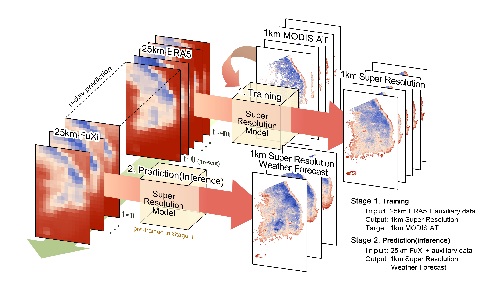

# SR-Weather

**A super-resolution framework for downscaling machine learning weather prediction toward 1-km air temperature**

[](https://doi.org/10.1038/s41612-026-01328-5)


## Overview

This repository provides the core implementation of **SR-Weather**, a deep learning-based super-resolution framework for high-resolution air temperature downscaling.

📄 **Paper:** [npj Climate and Atmospheric Science (2026)](https://doi.org/10.1038/s41612-026-01328-5)

## Framework



## Repository Structure

```text
SR-Weather/
├── model.py
├── scm.py
├── assets/
│   └── framework.png
└── README.md
```

## Code Description

- **model.py**: Implementation of the SR-Weather neural network architecture.
- **scm.py**: Implementation of the spatial contextual information construction.

## Code Availability

This repository contains the core model architecture and SCM construction code. The complete training pipeline, datasets, and pretrained weights are not included.

## Citation

If you find this work useful, please cite:

Park et al., *A super-resolution framework for downscaling machine learning weather prediction toward 1-km air temperature*, npj Climate and Atmospheric Science (2026).

https://doi.org/10.1038/s41612-026-01328-5
